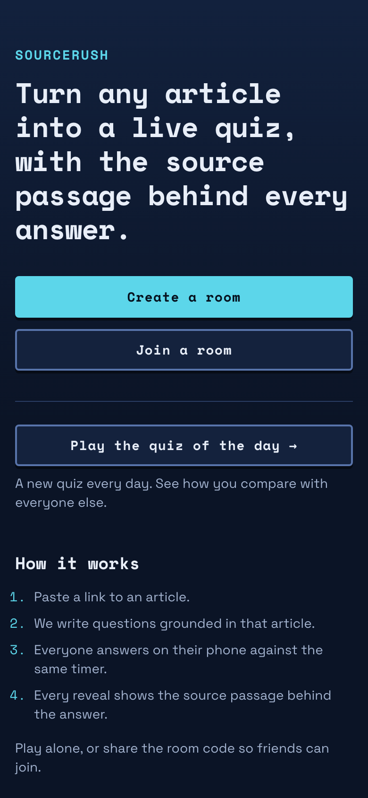
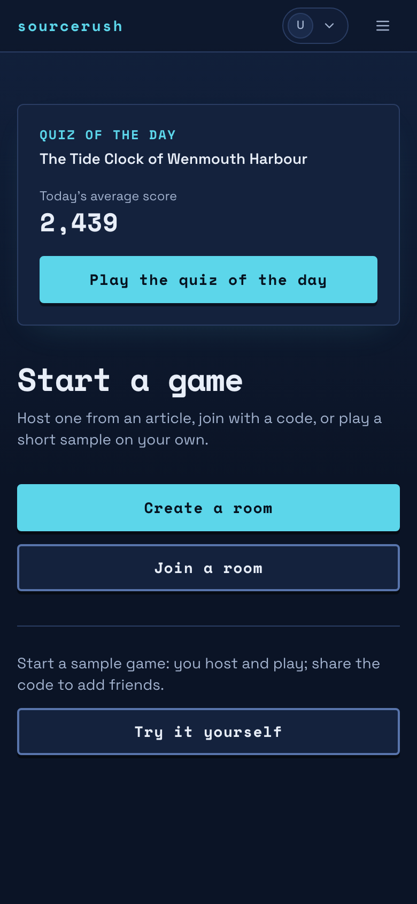
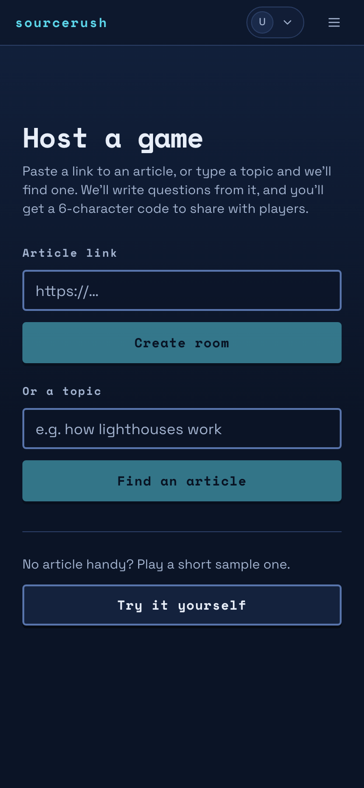
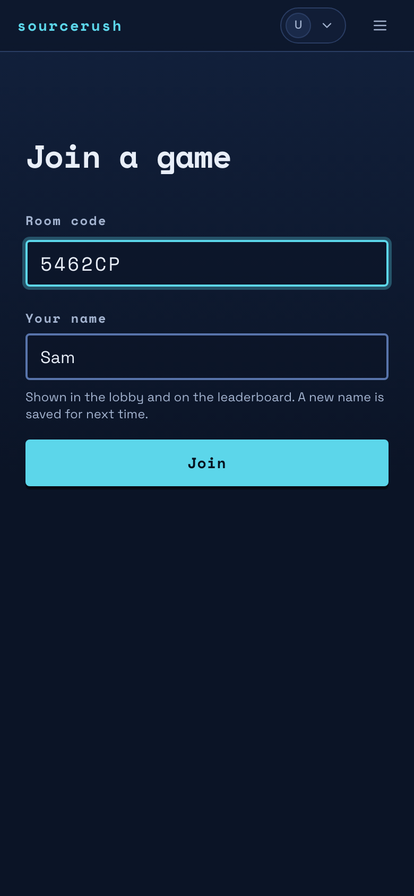
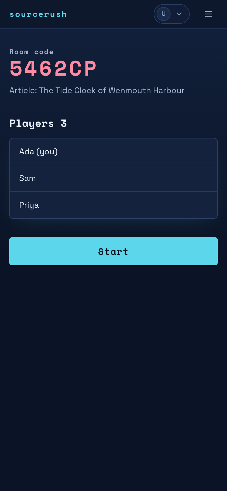
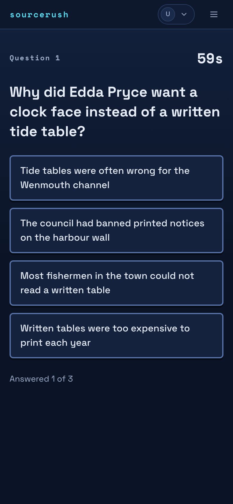
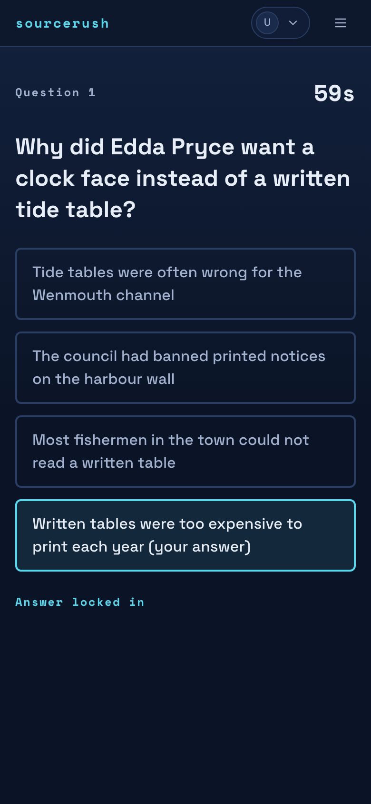
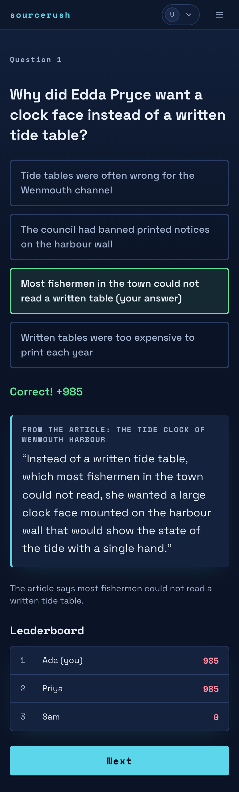
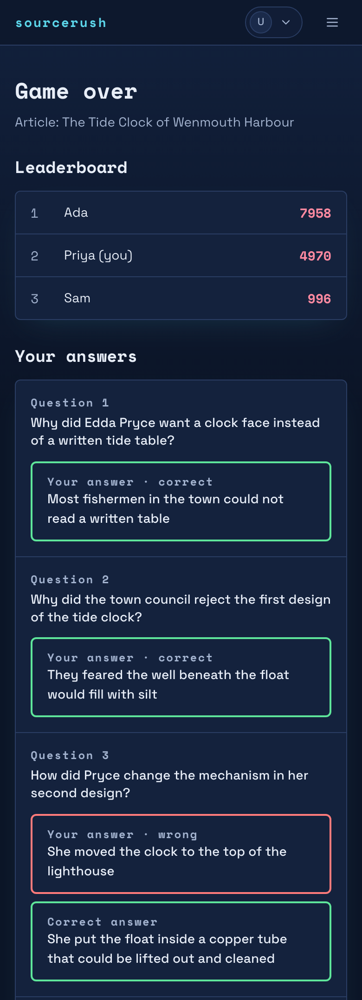
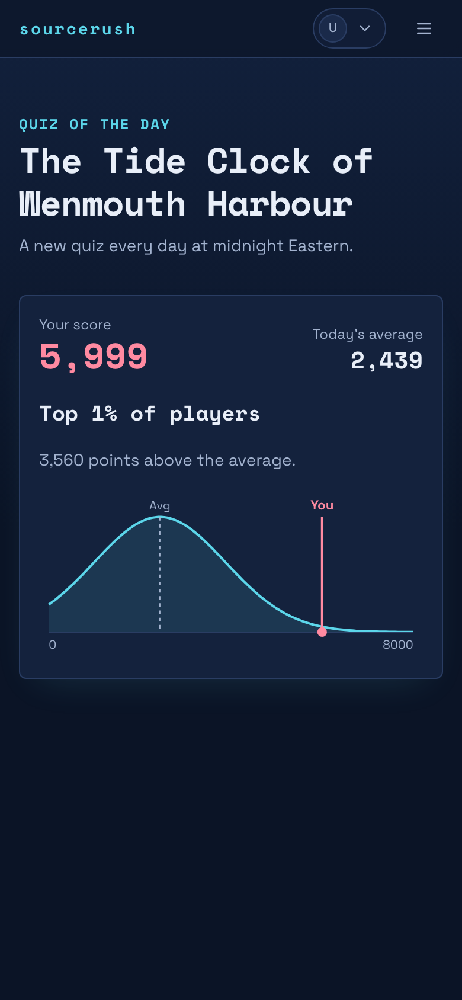

# SourceRush

Turn any article into a live multiplayer quiz, with the source passage behind every answer.

A host pastes an article link (or types a topic and SourceRush finds an article). The server writes questions grounded in that article. Players join with a 6-character room code and answer against a shared 60-second timer. Each reveal shows the exact passage from the article that supports the answer. There is also a **Quiz of the Day**: one solo attempt per person, scored against the day's average.

**Live:** <https://sourcerush.app.space>

## Screenshots

All screenshots come from a real local game with three players (Ada hosts, Sam and Priya join), using the built-in sample article.

| Landing | Home | Host a game |
| :---: | :---: | :---: |
|  |  |  |
| **Join with a code** | **Lobby** | **Question (host view)** |
|  |  |  |
| **Answer locked in** | **Reveal with source passage** | **Game over** |
|  |  |  |
| **Host name prompt** | **Quiz of the Day result** | |
|  |  | |

## Features

- **Three ways to start a room:** paste an article URL, type a topic (SourceRush searches for a suitable article), or click **Try it yourself** for a free sample game.
- **Grounded questions:** every question carries a verbatim passage from the article. The server rejects any question whose passage can't be found in the text the model was given.
- **Live multiplayer:** players join by code. Everyone sees the same question, the same countdown and the same reveal in real time. The host plays too.
- **Speed scoring:** a correct answer scores 500 points plus up to 500 more for answering quickly (`500 + round(500 × timeLeft / 60s)`). A wrong answer or no answer scores 0.
- **Answer review:** at Game over, each player sees their own answer to every question next to the correct one.
- **Quiz of the Day:** a new 8-question quiz every midnight (New York time), generated by a cron job from a rotating list of everyday topics. Each person gets one attempt. Results show your score against the day's average, an estimated "Top X%" and a bell curve. No names or individual scores are ever public.
- **Live generation progress:** while questions are being written, the host sees each step (searching, reading, writing, checking, saving) with elapsed time.
- **Refresh-safe:** reloading mid-game restores the full state from the server, including your locked-in answer.

## Tech stack

| Layer | What | Why |
| --- | --- | --- |
| Platform | [DeepSpace](https://docs.deep.space) SDK (`deepspace` 0.44) | Auth, real-time synced records with per-collection permissions, server actions, background jobs, cron, and metered integrations, all in one SDK |
| Runtime | Cloudflare Workers + Durable Objects (SQLite) | Deployed by `deepspace deploy` to `*.app.space`. Records, jobs and cron each run in their own Durable Object |
| Server routing | [Hono](https://hono.dev) (`worker.ts`, `src/server/`) | Small router for the worker's HTTP and WebSocket routes |
| Frontend | React 19, React Router 7 (file-based routes via `@generouted/react-router`) | Pages live in `src/pages/`. Data hooks only run inside the `(app)/` provider boundary |
| UI | Tailwind CSS 4, Base UI, lucide-react | Dark theme tokens in `src/themes.css` |
| Build | Vite 8 with `@cloudflare/vite-plugin`, TypeScript 5 | One dev server for the client and the worker (Miniflare) |
| Article search | Exa (`exa/search`) via DeepSpace integrations | Topic rooms: finds candidate articles and skips video and social sites |
| Article scraping | Firecrawl (`firecrawl/scrape`) | Fetches the article as Markdown. The app converts it to plain text |
| Question writing | Anthropic Claude (`anthropic/chat-completion`, model `claude-haiku-5-5`) | Writes 12 candidate questions with answers, passages and explanations |
| Tests | Vitest (unit), Playwright (`deepspace test run`) | Unit tests for the pure logic; end-to-end specs against local dev with real test accounts |

Integration calls go through DeepSpace's integration proxy, billed to the app owner. No API keys live in the code. Secrets are managed with `npx deepspace secrets`.

## How it works

### Game flow

```
generating ──► lobby ──► question ──► reveal ──► question ──► … ──► finished
     │
     └──► failed (with a user-safe error message)
```

Every state change goes through a **server action** (`src/actions/index.ts`). The client never writes game state:

| Action | Who | What it does |
| --- | --- | --- |
| `createRoom` | any signed-in user | Validates `{ url }`, `{ topic }` or `{ sample: true }`, claims a daily quota slot (10 rooms per user per day), creates the room and queues the generation job |
| `joinRoom` | any signed-in user | Adds the caller as a player (identity always comes from the verified JWT) |
| `openQuestion` | host only | Copies the next question's prompt and choices (no answer) to the clients and starts the 60 s timer (server clock) |
| `submitAnswer` | players | Accepts one answer per player per question, only while the question is open and before `endsAt` |
| `revealQuestion` | any member | Once time is up or everyone has answered, scores the round exactly once and publishes the answer, passage and explanation |
| `playDailyQuiz` | any signed-in user | Creates (or returns) the caller's one solo room for today's quiz |

### Question pipeline

Generation runs as a background job (`src/jobs.ts`), so the host isn't left waiting on a single request:

1. **Search** (topic rooms only): Exa returns up to 5 articles. If one is too short or unreachable, the job tries the next, within a 30 s total scrape budget.
2. **Scrape**: Firecrawl → Markdown → plain text. Articles under 2,000 characters are rejected.
3. **Generate**: Claude writes 12 questions ordered easiest to hardest, each with a verbatim supporting passage.
4. **Validate**: parse the output, drop any question whose passage isn't in the source text, check the choices, and shuffle them. At least 8 must survive; otherwise the job regenerates once.
5. **Store**: answer keys and source text are saved in server-only collections, and the room moves to `lobby`.

The steps live in pure, unit-tested modules in `src/lib/questions/` (`prompt.ts`, `validate.ts`, `prepare.ts`, `markdown.ts`, `responses.ts`, `pipeline.ts`). They make no SDK or network calls; the job injects the real `scrape`/`generate` functions, and the sample room injects fixed ones.

### Security model

The core rule: **anything synced to a client is readable by that client**, even if the UI hides it. So:

- Correct answers live in `answerKeys`, a collection with `read: false` for every role. Clients get a question's prompt and choices only when it opens, and the answer only at reveal.
- Room data (`rooms`, `players`, `questions`) is readable only by room members, using DeepSpace's `'team'` read level backed by `team_members`.
- `submissions` and `daily_plays` are readable only by their owner. Players never see each other's picks.
- **One submission per player per question** is enforced inside a single database write: every submission carries an immutable, server-generated `attemptId`, so a second write for the same id is rejected (`Cannot modify immutable field`). A plain check-then-write would race.
- **One scoring per question** uses the same trick on a `reveal_locks` row, so concurrent `revealQuestion` calls can't double-score.
- Timers are display-only on the client. The server rejects late answers using its own clock.

These guarantees are covered by `tests/game.spec.ts`, which probes the records socket directly as a modified client would.

### Data model

| Collection | Holds | Readable by |
| --- | --- | --- |
| `users` | profile + chosen display name | owner |
| `rooms` | code, host, status, current question, timer | room members |
| `players` | name and score per room | room members |
| `questions` | prompt, choices, reveal (empty until revealed) | room members |
| `answerKeys` | correct answer, passage, explanation | server only |
| `sources` | the article text the model saw | server only |
| `submissions` | one answer per player per question | owner only |
| `team_members`, `reveal_locks`, `room_quota`, `daily_quizzes` | membership, scoring lock, rate limit, daily generation state | server only |
| `daily_stats` | today's title, question count and average score | any signed-in user |
| `daily_plays` | your daily attempt and result | owner only |

Schemas are in `src/schemas/`. [CLAUDE.md](CLAUDE.md) has the full field-level reference.

## Project structure

```
worker.ts                 Worker entry: routes, Durable Objects, jobs, cron
src/
  actions/index.ts        All server actions (game rules live here)
  jobs.ts                 Background question-generation job
  cron.ts                 Quiz of the Day cron (every 15 min, New York time)
  server/                 Integration calls (generation.ts), daily logic, routes
  schemas/                Collection schemas and permissions
  lib/                    Pure logic: scoring, daily stats, names, params
    questions/            Pure question pipeline + fixtures
  pages/                  File-based routes: /, /home, /create, /join, /daily, /room/:id
  components/game/        Lobby, question, reveal, leaderboard, daily result, bell curve
tests/                    Playwright specs (game rules, UI, landing, lobby)
```

## Running locally

Requires Node 22, 24 or 26 and npm ≥ 11.6.

```bash
npm install
npx deepspace auth login     # sign in to DeepSpace
npx deepspace dev start      # Vite + Miniflare at http://localhost:5173
```

**Try it yourself** works locally with no API calls. Article and topic rooms call the paid integrations through your DeepSpace account. The Quiz of the Day cron skips generation in local dev; tests seed it with the sample instead.

## Testing

```bash
npm run test:unit            # Vitest: 128 tests across 13 files (pipeline, scoring, daily, …)
npx deepspace test run       # smoke + API specs
npx deepspace test run all   # every Playwright spec, against a fresh local server
```

The Playwright specs sign in as real DeepSpace test accounts and play full games: create, join, answer, refresh mid-question, reveal, finish. They also check the integrity rules: players can't read answer keys, a double submit counts once, late answers are rejected, and non-hosts can't advance the game. Specs only use the sample room, so a test run never calls a paid integration.

## Deploying

```bash
npx deepspace deploy         # ships the local working tree to sourcerush.app.space
```

This repo's source authority is GitHub, so commit (and push) before deploying, and don't run `npx deepspace push`.

## Known limitations

- If a worker dies mid-generation, the room stays in `generating`. After 3 minutes the page shows "taking longer than expected", but nothing ends the room server-side.
- The Quiz of the Day "Top X%" is estimated from a normal curve fitted to the average and spread (including a seeded baseline), not a true rank.
- A player loses read access to rooms they joined more than 2 hours ago. This works around a per-query parameter limit in the SDK's team permissions.
- A user who joins a room while a page is already open may not see earlier records until they navigate to a fresh page (an SDK subscription issue; the app navigates after joining).

## Development log

This was built as an internship exercise with an AI coding agent. Every change, what was verified, and what wasn't, is recorded in [AGENT_LOG.md](AGENT_LOG.md). Working rules for the agent are in [CLAUDE.md](CLAUDE.md).
